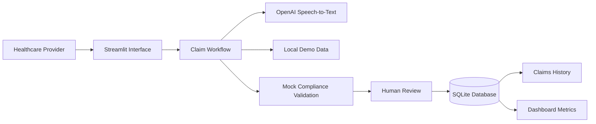

<div align="center">

# Aoun | عون

### Validate Earlier. Submit Stronger Claims.

An AI-assisted healthcare claims validation prototype built with Python, Streamlit, OpenAI, Pydantic, SQLAlchemy, and SQLite.

</div>

---

## Overview

Aoun is a human-supervised healthcare claims validation platform designed to support healthcare providers before submitting insurance claims.

The platform guides healthcare professionals through patient selection, encounter information, clinical documentation, diagnosis and procedure selection, supporting-document upload, and pre-submission validation.

Aoun is conceptually positioned between healthcare providers and NPHIES:

```text
Healthcare Provider → Aoun → NPHIES → Insurance Company
```

The current version is a local demonstration. It does not connect to production NPHIES systems, insurance companies, or real hospital infrastructure.

---

## Problem

Healthcare claims may be rejected or delayed because of:

- Missing clinical documentation
- Incorrect diagnosis or procedure codes
- Diagnosis–procedure mismatches
- Incomplete medical justification
- Missing supporting documents
- Administrative inconsistencies
- Payer-policy compliance issues

These problems can increase administrative workload, delay reimbursement, and require repeated claim submissions.

Aoun aims to identify potential issues before the claim is sent to the payer.

---

## Proposed Solution

Aoun provides a guided claims-validation workflow that:

- Helps healthcare professionals complete claim information
- Reviews clinical and administrative data before submission
- Detects potential diagnosis–procedure mismatches
- Highlights blocking compliance issues
- Explains why the claim may require correction
- Suggests actions to improve the claim
- Calculates a claim compliance score
- Estimates the probability of claim acceptance
- Preserves human review before submission
- Stores reviewed claims in a persistent local database

---

## Key Features

- Guided healthcare claim creation workflow
- Automatic patient and insurance data loading
- Provider and encounter documentation
- Clinical note entry through typing
- Speech-to-text clinical documentation
- Diagnosis, procedure, and medication selection
- Supporting-document upload
- Mock diagnosis–procedure compatibility validation
- Claim compliance score
- Estimated claim acceptance probability
- Blocking compliance issues
- Correction suggestions
- Visible passed compliance checks
- Human review before claim submission
- Persistent claim storage using SQLite
- Claims history table
- Dashboard metrics calculated from saved claims
- English and Arabic layout support
- Large-text accessibility option
- Responsive Streamlit interface

---

## Current Demo Workflow

```text
Healthcare Provider
        ↓
Patient and insurance
        ↓
Provider and visit
        ↓
Clinical documentation
        ↓
Diagnosis and services
        ↓
Supporting documents
        ↓
Aoun validation
        ↓
Return and correct / Save as draft / Submit claim
        ↓
SQLite claim history
        ↓
Dashboard metrics
```

---

## Product Demo

A short walkthrough of the Aoun healthcare claims validation workflow is included in the repository.

[▶ Watch the Aoun Product Demo](assets/Aoun_Product_Demo.mp4)

The demonstration covers:

- Patient and insurance selection
- Provider and visit information
- Clinical documentation using typing or speech-to-text
- Diagnosis and procedure selection
- Supporting-document upload
- Claim compliance validation
- Diagnosis–procedure mismatch detection
- Claim correction
- Claim submission
- Dashboard updates
- Claims-history updates

---

## Validation Demonstration

The current prototype uses deterministic mock validation logic to demonstrate the intended product behavior.

### Compatible Claim Example

```text
Diagnosis:
M54.5 — Low back pain

Procedure:
72148 — MRI lumbar spine without contrast
```

Expected result:

```text
Claim compliance score: 90%
Estimated acceptance: 86%
Status: Ready for submission
Blocking issues: None
```

### Diagnosis–Procedure Mismatch Example

```text
Diagnosis:
M54.5 — Low back pain

Procedure:
71045 — Chest radiograph
```

Expected result:

```text
Claim compliance score: 50%
Estimated acceptance: 42%
Status: Needs correction
Blocking issue: Diagnosis and procedure mismatch
```

Suggested action:

```text
Review the diagnosis, select a clinically related service,
or strengthen the clinical justification.
```

These scores are demonstration values only. They do not represent production payer decisions, official insurance policies, or NPHIES adjudication rules.

---

## System Architecture



---

## Technology Stack

- Python
- Streamlit
- OpenAI API
- Pydantic
- SQLAlchemy
- SQLite
- Pandas
- python-dotenv

---

## Project Structure

```text
aoun/
│
├── assets/
│   ├── Aoun_Logo.png
│   ├── Aoun_word_logo.png
│   └── Aoun_Product_Demo.mp4
│
├── components/
│   ├── __init__.py
│   └── branding.py
│
├── config/
│   ├── __init__.py
│   └── settings.py
│
├── data/
│   ├── uploads/
│   │   └── .gitkeep
│   └── aoun_data.json
│
├── database/
│   ├── __init__.py
│   ├── models.py
│   └── session.py
│
├── docs/
│   ├── architecture.md
│   └── workflow.md
│
├── schemas/
│   ├── __init__.py
│   └── claim.py
│
├── services/
│   ├── __init__.py
│   ├── claim_builder.py
│   ├── mock_directory.py
│   ├── openai_client.py
│   ├── repository.py
│   └── speech_to_text.py
│
├── views/
│   ├── __init__.py
│   ├── claims.py
│   ├── dashboard.py
│   └── history.py
│
├── .env.example
├── .gitignore
├── app.py
├── README.md
└── requirements.txt
```

The following local runtime files should not be committed to GitHub:

```text
.env
.venv/
__pycache__/
aoun.db
data/uploads/*
```

---

## Installation

### 1. Clone the Repository

```bash
git clone https://github.com/YOUR_USERNAME/aoun.git
cd aoun
```

### 2. Create a Virtual Environment

#### Windows PowerShell

```powershell
python -m venv .venv
.\.venv\Scripts\Activate.ps1
```

If PowerShell blocks activation:

```powershell
Set-ExecutionPolicy -Scope Process -ExecutionPolicy Bypass
.\.venv\Scripts\Activate.ps1
```

#### macOS or Linux

```bash
python3 -m venv .venv
source .venv/bin/activate
```

### 3. Install the Dependencies

```bash
python -m pip install --upgrade pip
python -m pip install -r requirements.txt
```

---

## Environment Configuration

Copy the example environment file.

### Windows PowerShell

```powershell
Copy-Item .env.example .env
```

### macOS or Linux

```bash
cp .env.example .env
```

Add your OpenAI API key to `.env`:

```env
# OpenAI API key
OPENAI_API_KEY=your_openai_api_key_here

# Main text model
OPENAI_MODEL=gpt-4.1-mini

# Speech-to-text model
OPENAI_STT_MODEL=gpt-4o-mini-transcribe

# Text-to-speech model
OPENAI_TTS_MODEL=gpt-4o-mini-tts

# Voice used for text-to-speech
OPENAI_TTS_VOICE=coral

# Local SQLite database
DATABASE_URL=sqlite:///./aoun.db
```

Never commit the `.env` file or expose a real API key publicly.

---

## Running the Application

Run:

```bash
streamlit run app.py
```

The application should open automatically in the browser.

Default local address:

```text
http://localhost:8501
```

---

## Data and Persistence

### Demonstration Data

The following file contains the local demonstration data used by Aoun:

```text
data/aoun_data.json
```

It includes:

- Patients
- Insurance information
- Providers
- Diagnosis codes
- Procedure codes
- Medication codes
- Insurance-policy information

The included data is synthetic and intended only for demonstration.

### Claim Database

Reviewed and submitted claims are stored locally in:

```text
aoun.db
```

The database is created automatically using SQLite and SQLAlchemy.

Because it is a local runtime artifact and may contain claim information, it should not be committed to GitHub.

### Supporting Documents

Uploaded supporting files are stored locally in:

```text
data/uploads/
```

Uploaded documents should not be committed to GitHub.

The repository should keep only:

```text
data/uploads/.gitkeep
```

---

## Dataset Assessment

A public healthcare claims dataset was reviewed as an additional supporting resource:

```text
https://github.com/shivaprasad1808/Healthcare_claims_dataset
```

The dataset contains fields such as:

- Claim ID
- Provider ID
- Patient ID
- Date of service
- Billed amount
- Procedure code
- Diagnosis code
- Allowed amount
- Paid amount
- Insurance type
- Claim status
- Reason code
- Follow-up requirement
- Accounts-receivable status
- Outcome

The dataset may support future Aoun work in:

- Claims analytics
- Rejection-pattern exploration
- Feature engineering
- Baseline acceptance or rejection modelling
- Dashboard prototyping
- Claim-status analysis

### Dataset Limitations

- It is not Saudi-specific.
- It is not official NPHIES data.
- It is not NPHIES ground truth.
- It does not contain official payer policies.
- It should not be presented as evidence of production adjudication accuracy.
- The current live validation demonstration does not depend on this dataset.

---

## Accessibility

The current interface supports:

- English and Arabic layout direction
- Large-text mode
- Keyboard-focus styling
- Minimum control sizing
- Speech-to-text clinical documentation

Text-to-speech environment settings are included for future accessibility development, but text-to-speech is not currently integrated into the active claims workflow.

---

## Current Limitations

The current Aoun version is a prototype.

It does not:

- Connect to production NPHIES
- Submit real healthcare claims
- Connect to insurance-company systems
- Connect to hospital information systems
- Apply official payer adjudication rules
- Guarantee claim acceptance
- Replace physician judgment
- Replace medical coders
- Replace claims specialists
- Use real patient information in the demonstration dataset
- Provide production clinical or financial recommendations

---

## Production Requirements

Before production deployment, Aoun would require:

- Official NPHIES integration
- Approved Saudi healthcare terminology and coding standards
- Payer-specific policy contracts
- Hospital information-system integration
- Role-based access control
- Single sign-on
- Secure secrets management
- Encryption in transit and at rest
- Secure document storage
- Immutable audit logs
- Patient-data protection controls
- Data-residency compliance
- Clinical governance
- Regulatory approval
- Penetration testing
- Monitoring and observability
- Model-performance monitoring
- Bias and safety evaluation
- Human review and escalation procedures

---

## Future Development

- Official NPHIES integration
- Hospital information-system integration
- Insurance eligibility verification
- Payer-specific policy validation
- Saudi coding and terminology support
- Prior-authorization validation
- Explainable claim-risk modelling
- Real-time correction suggestions
- Role-based user accounts
- Audit logs
- Secure cloud document storage
- Arabic clinical natural-language processing
- Text-to-speech feedback
- Claim-status tracking
- Payer-response integration
- Production monitoring and governance

---

## Demo Materials

The complete project submission may be organized as follows:

```text
Aoun – AI Healthcare Claims Validation/
│
├── 01_Aoun_Pitch_Deck.pdf
├── 02_Aoun_Product_Demo.mp4
│
└── 03_Additional_Resources/
    └── Datasets/
        └── Healthcare_Claims_Dataset_Public_Sample/
```

---

## Team

Aoun was developed by:

- **ملاك حاتم الوجيد**
- **نوره عساف أبوتين**
- **منار الحواس**
- **فاطمة محمد مشقق**

---

## Disclaimer

Aoun is an educational demonstration project.

It does not connect to production NPHIES services and must not be used to process real patient information, submit real healthcare claims, or make real insurance-adjudication decisions.
