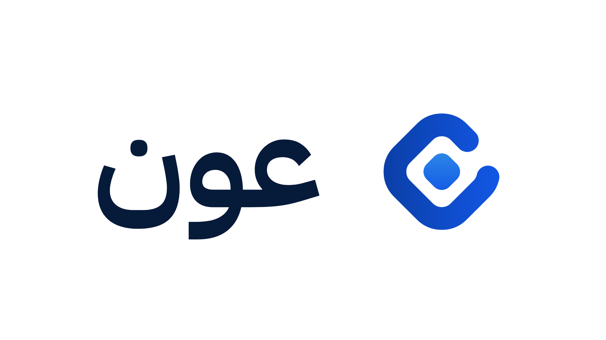
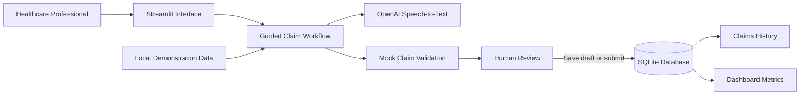

<div align="center">



# Aoun | عون

### *Validate Earlier. Submit Stronger Claims.*

An AI-assisted healthcare claims validation platform built with **Python**, **Streamlit**, **OpenAI**, **Pydantic**, **SQLAlchemy**, and **SQLite**.

[](https://www.python.org/)
[](https://streamlit.io/)
[](https://openai.com/)
[](https://www.sqlite.org/)
[](https://www.sqlalchemy.org/)

</div>

---

## Overview

**Aoun** is a human-supervised healthcare claims validation platform designed to help healthcare providers identify and correct potential claim issues before submission.

The platform guides healthcare professionals through clinical documentation, diagnosis and procedure selection, supporting-document upload, and pre-submission validation. Administrative, insurance, and financial information is loaded automatically from local demonstration data to reduce unnecessary manual work for physicians.

Aoun is conceptually positioned between healthcare providers and NPHIES:

```text
Healthcare Provider → Aoun → NPHIES → Insurance Company
```

Unlike a standard claim-entry form, Aoun evaluates the claim before submission, highlights possible issues, explains why correction may be required, and suggests actions that can strengthen the claim.

The current version is a local educational prototype. It does not connect to production NPHIES services, hospital systems, insurance companies, or real patient records.

---

## Problem

Healthcare claims may be rejected or delayed because of:

- Missing clinical documentation
- Incorrect diagnosis or procedure codes
- Diagnosis–procedure mismatches
- Incomplete medical justification
- Missing supporting documents
- Administrative inconsistencies
- Payer-policy compliance issues

These issues increase administrative workload, delay reimbursement, and may require repeated claim submissions.

Aoun aims to detect potential problems earlier, while the healthcare professional is preparing the claim.

---

## Proposed Solution

Aoun provides a guided pre-submission validation workflow that:

- Loads patient, insurance, provider, and financial information automatically
- Allows clinical documentation through typing or speech-to-text
- Reviews clinical and administrative claim information
- Detects potential diagnosis–procedure mismatches
- Highlights blocking compliance issues
- Explains why the claim may require correction
- Suggests actions to improve claim completeness
- Calculates a claim compliance score
- Estimates the probability of claim acceptance
- Preserves human review before submission
- Stores reviewed claims in a persistent local database

---

## Key Features

- Guided healthcare claim creation workflow
- Automatic patient and insurance data loading
- Automatic provider and financial information loading
- Clinical note entry through typing
- Speech-to-text clinical documentation
- Diagnosis, procedure, and medication selection
- Supporting-document upload
- Mock diagnosis–procedure compatibility validation
- Claim compliance score
- Estimated claim acceptance probability
- Blocking compliance issues
- Correction suggestions
- Visible passed compliance checks
- Return-and-correct workflow
- Save-as-draft option
- Human review before claim submission
- Persistent claim storage using SQLite
- Claims history table
- Dashboard metrics calculated from saved claims
- English and Arabic layout support
- Large-text accessibility option
- Responsive Streamlit interface

---

## Required End-to-End Workflow

Aoun supports the complete demonstration scenario below.

### 1. Select Patient and Encounter

The user selects a patient and encounter.

The system automatically loads:

- Patient information
- Insurance information
- Provider information
- Visit details
- Administrative information
- Financial information

This reflects the intended production design, where information already available in hospital systems should not be manually re-entered by physicians.

### 2. Add Clinical Documentation

The healthcare professional documents the clinical case using either:

- A written clinical note
- A recorded voice note converted through speech-to-text

Completing either method allows the user to continue to the next step.

### 3. Select Diagnosis and Services

The healthcare professional selects:

- Diagnosis code
- Procedure or service code
- Medication, when applicable

### 4. Upload Supporting Documents

Relevant supporting files can be attached to strengthen the claim documentation.

### 5. Run Aoun Validation

Aoun reviews the completed claim and returns:

- Compliance score
- Estimated acceptance probability
- Blocking issues
- Passed checks
- Correction suggestions
- Readiness status

### 6. Review and Submit

Based on the validation result, the user can:

- Return and correct the claim
- Save the claim as a draft
- Submit the claim

Submitted and saved claims are stored in SQLite and reflected in the dashboard and claims-history pages.

---

## Current Demo Workflow

```text
Healthcare Provider
        ↓
Select patient and encounter
        ↓
Automatically load administrative, insurance, and financial data
        ↓
Enter or record clinical documentation
        ↓
Select diagnosis, procedures, and medications
        ↓
Upload supporting documents
        ↓
Run Aoun validation
        ↓
Review score, issues, checks, and suggestions
        ↓
Return and correct / Save as draft / Submit claim
        ↓
SQLite claim history
        ↓
Dashboard metrics
```

---

## Aoun in Action

A short walkthrough of the Aoun healthcare claims validation workflow is included in the repository.

[▶ Watch the Aoun Product Demo](assets/Aoun_Product_Demo.mp4)

The demonstration covers:

- Patient and insurance selection
- Automatic administrative and financial data loading
- Provider and visit information
- Clinical documentation through typing or speech-to-text
- Diagnosis and procedure selection
- Supporting-document upload
- Claim compliance validation
- Diagnosis–procedure mismatch detection
- Claim correction
- Claim submission
- Dashboard updates
- Claims-history updates

---

## Validation Demonstration

The current prototype uses deterministic mock validation logic to demonstrate the intended product behavior.

### Compatible Claim Example

```text
Diagnosis:
M54.5 — Low back pain

Procedure:
72148 — MRI lumbar spine without contrast
```

Expected result:

```text
Claim compliance score: 90%
Estimated acceptance: 86%
Status: Ready for submission
Blocking issues: None
```

### Diagnosis–Procedure Mismatch Example

```text
Diagnosis:
M54.5 — Low back pain

Procedure:
71045 — Chest radiograph
```

Expected result:

```text
Claim compliance score: 50%
Estimated acceptance: 42%
Status: Needs correction
Blocking issue: Diagnosis and procedure mismatch
```

Suggested action:

```text
Review the diagnosis, select a clinically related service,
or strengthen the clinical justification.
```

These values are included only to demonstrate the interface and workflow. They do not represent official payer decisions, production prediction accuracy, insurance policies, or NPHIES adjudication rules.

---

## System Architecture

Aoun currently uses a modular application architecture with a Streamlit interface, typed claim schemas, service modules, and persistent local storage.



---

## Application Components

| Component | Responsibility |
|---|---|
| **Streamlit Interface** | Provides the dashboard, claim workflow, history page, language controls, and accessibility options. |
| **Claim Workflow** | Guides the user through the required claim-preparation steps. |
| **Mock Directory Service** | Loads synthetic patient, insurance, provider, diagnosis, procedure, medication, and policy data. |
| **Speech-to-Text Service** | Converts recorded clinical documentation into text. |
| **Claim Builder** | Combines workflow inputs into a structured claim object. |
| **Validation Logic** | Applies deterministic demonstration rules and returns scores, issues, checks, and suggestions. |
| **Repository Layer** | Saves and retrieves claim records. |
| **SQLite Database** | Persists drafts and submitted claims locally. |
| **Dashboard and History** | Displays saved-claim metrics and claim records. |

---

## Design Decisions

### Human-Supervised Validation

Aoun does not submit a claim automatically after validation. The healthcare professional remains responsible for reviewing the result and deciding whether to correct, save, or submit the claim.

### Reduced Physician Data Entry

Patient, insurance, provider, administrative, and financial information is automatically loaded in the demonstration. In a production environment, this information would be retrieved from connected hospital systems.

The physician is primarily responsible for the clinical portion of the claim rather than manually entering information that already exists elsewhere.

### Clinical Documentation by Text or Voice

The clinical documentation step accepts either a typed note or a voice recording. The user does not need to complete both methods.

### Deterministic Demonstration Logic

The current prototype uses rule-based mock validation instead of claiming production AI adjudication accuracy. This makes the demonstration transparent and prevents unsupported claims about real acceptance decisions.

---

## Data Flow

Aoun separates automatically loaded information from healthcare-professional input.

| Data Group | Current Source |
|---|---|
| Patient demographics | Local demonstration data |
| Insurance information | Local demonstration data |
| Provider information | Local demonstration data |
| Encounter information | Local demonstration data and workflow selection |
| Administrative information | Local demonstration data |
| Financial information | Local demonstration data |
| Clinical documentation | Healthcare professional |
| Diagnosis and procedures | Healthcare professional |
| Supporting documents | Healthcare professional |
| Validation result | Deterministic demonstration logic |
| Claim status | User review and action |

In production, the automatically loaded fields would be obtained through approved hospital and NPHIES integrations.

---

## Safety and Guardrails

Aoun includes several prototype-level safeguards.

### Synthetic Demonstration Data

The included data is synthetic and intended only for demonstration.

Real patient information must not be entered into the prototype.

### Human Review

Aoun preserves human review before submission and does not replace:

- Physician judgment
- Medical coders
- Claims specialists
- Payer adjudication
- Clinical governance

### Transparent Validation Scope

The interface clearly separates demonstration scores from official payer decisions.

### Local File Handling

Uploaded supporting documents are stored locally in:

```text
data/uploads/
```

Runtime uploads and the SQLite database should not be committed to GitHub.

### Environment Secrets

API keys are stored through environment variables and should never be committed publicly.

---

## Accessibility

The current interface supports:

- English and Arabic layout direction
- Large-text mode
- Keyboard-focus styling
- Minimum control sizing
- Speech-to-text clinical documentation

Text-to-speech configuration is included for future development, but text-to-speech is not currently integrated into the active claim workflow.

---

## Technology Stack

- Python
- Streamlit
- OpenAI API
- Pydantic
- SQLAlchemy
- SQLite
- Pandas
- python-dotenv

---

## Installation

### 1. Clone the Repository

```bash
git clone https://github.com/YOUR_USERNAME/aoun.git
cd aoun
```

### 2. Create a Virtual Environment

#### Windows PowerShell

```powershell
python -m venv .venv
.\.venv\Scripts\Activate.ps1
```

If PowerShell blocks activation:

```powershell
Set-ExecutionPolicy -Scope Process -ExecutionPolicy Bypass
.\.venv\Scripts\Activate.ps1
```

#### macOS or Linux

```bash
python3 -m venv .venv
source .venv/bin/activate
```

### 3. Install Dependencies

```bash
python -m pip install --upgrade pip
python -m pip install -r requirements.txt
```

---

## Environment Configuration

Copy the example environment file.

### Windows PowerShell

```powershell
Copy-Item .env.example .env
```

### macOS or Linux

```bash
cp .env.example .env
```

Add the required values:

```env
# OpenAI API key
OPENAI_API_KEY=your_openai_api_key_here

# Main text model
OPENAI_MODEL=gpt-4.1-mini

# Speech-to-text model
OPENAI_STT_MODEL=gpt-4o-mini-transcribe

# Text-to-speech model reserved for future development
OPENAI_TTS_MODEL=gpt-4o-mini-tts

# Voice reserved for future text-to-speech development
OPENAI_TTS_VOICE=coral

# Local SQLite database
DATABASE_URL=sqlite:///./aoun.db
```

Never commit the `.env` file or expose a real API key publicly.

---

## Running the Application

Start the Streamlit application:

```bash
streamlit run app.py
```

The application should open automatically in the browser.

Default local address:

```text
http://localhost:8501
```

---

## Data and Persistence

### Demonstration Data

The local demonstration dataset is stored in:

```text
data/aoun_data.json
```

It includes:

- Patients
- Insurance information
- Providers
- Diagnosis codes
- Procedure codes
- Medication codes
- Insurance-policy information

The included data is synthetic and intended only for demonstration.

### Claim Database

Draft and submitted claims are stored locally in:

```text
aoun.db
```

The database is created automatically using SQLite and SQLAlchemy.

Because it is a runtime artifact and may contain claim information, it should not be committed to GitHub.

### Supporting Documents

Uploaded supporting files are stored in:

```text
data/uploads/
```

The repository should retain only:

```text
data/uploads/.gitkeep
```

---

## Dataset Assessment

A public healthcare claims dataset was reviewed as an additional supporting resource:

```text
https://github.com/shivaprasad1808/Healthcare_claims_dataset
```

The dataset contains fields such as:

- Claim ID
- Provider ID
- Patient ID
- Date of service
- Billed amount
- Procedure code
- Diagnosis code
- Allowed amount
- Paid amount
- Insurance type
- Claim status
- Reason code
- Follow-up requirement
- Accounts-receivable status
- Outcome

---

## Requirements Coverage

| Project Capability | Current Implementation |
|---|---|
| Guided claim workflow | Multi-step Streamlit claim form |
| Automatic information loading | Synthetic local patient, insurance, provider, and financial data |
| Clinical documentation | Typed note or OpenAI speech-to-text |
| Diagnosis and procedure selection | Local demonstration directories |
| Supporting documents | Local file upload |
| Pre-submission validation | Deterministic mock validation rules |
| Explainable feedback | Issues, passed checks, and correction suggestions |
| Compliance score | Demonstration score |
| Acceptance estimate | Demonstration probability |
| Human review | Correct, save as draft, or submit |
| Persistence | SQLite and SQLAlchemy |
| Claim history | Saved claims table |
| Dashboard | Metrics generated from stored claims |
| Accessibility | Arabic/English layouts, large text, and speech input |

---

## Team

Aoun was developed by:
- Fatima Mushfiq
- Manar Alhawas
- Malak Abuhimed
- Noura Abuthnain

---

## Disclaimer

Aoun is an educational demonstration project.

It does not connect to production NPHIES services and must not be used to process real patient information, submit real healthcare claims, provide clinical recommendations, or make real insurance-adjudication decisions.

---

<div align="center">

### Aoun | عون

*Validate Earlier. Submit Stronger Claims.*

</div>
